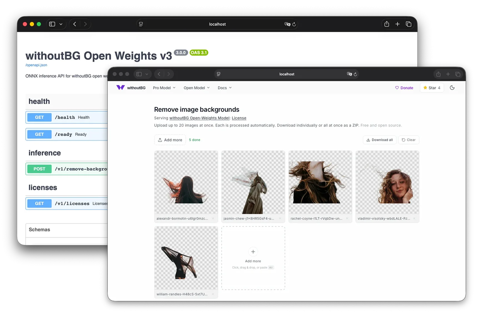
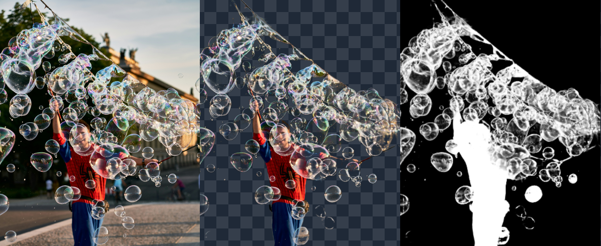
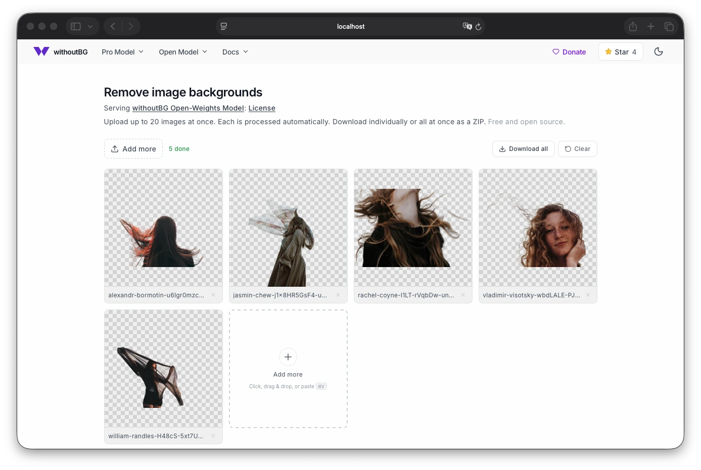
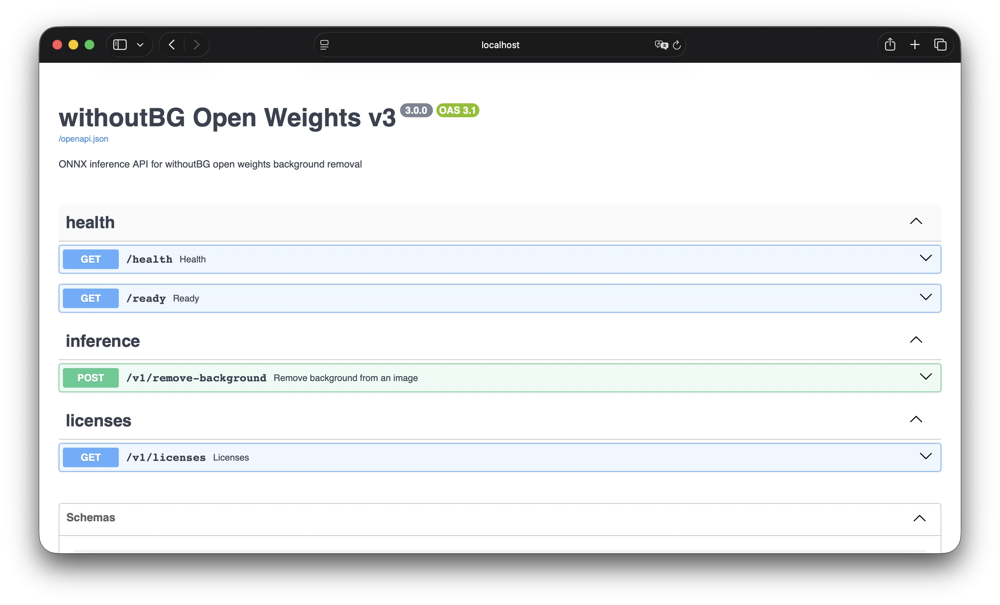

# withoutBG Open Weights Inference (v4)



**Self-host background removal. Docker images and FastAPI for the withoutBG open weights ONNX model — CPU or NVIDIA GPU.**

Run a browser UI, a headless API, or both. Same open-weights quality as the Python package and Mac app, on your own server.

**New in v4: Smart brush.** Not happy with a cutout? Open it, pick **Smart brush**, paint
green over what went missing and red over what should go, press **Apply**. One stroke on an object
is enough; the rest of the image stays as it was. Same thing over the API:

```bash
# remove_mask / keep_mask: same size as the image, white = painted; matte: the previous result
curl -F image=@photo.jpg -F remove_mask=@remove.png -F matte=@photo-cutout.png \
  http://localhost:8000/v1/remove-background -o fixed.png
```

Brushing the same image several times? Send JSON instead: each edit response carries an
`editContext`. Pass it back as `edit_context` with the next edit (plus `matte` and a mask) and the
server runs only the Smart brush graph, not the full pipeline. A stale value is ignored, never an error.

**[Docker docs →](https://withoutbg.com/docs/open-model/docker?utm_source=github&utm_medium=readme&utm_campaign=open-weights-v4&utm_content=withoutbg-inference-docs-open-model-docker)** · **[GPU docs →](https://withoutbg.com/docs/open-model/docker-gpu?utm_source=github&utm_medium=readme&utm_campaign=open-weights-v4&utm_content=withoutbg-inference-docs-open-model-docker-gpu)** · **[Local API docs →](https://withoutbg.com/docs/open-model/local-api?utm_source=github&utm_medium=readme&utm_campaign=open-weights-v4&utm_content=withoutbg-inference-docs-open-model-local-api)**

## See the results




**[Open Weights results →](https://withoutbg.com/open-model/results?utm_source=github&utm_medium=readme&utm_campaign=open-weights-v4&utm_content=withoutbg-inference-open-model-results)** · **[Cloud API results →](https://withoutbg.com/pro-model/results?utm_source=github&utm_medium=readme&utm_campaign=open-weights-v4&utm_content=withoutbg-inference-pro-model-results)** · **[Compare →](https://withoutbg.com/compare/withoutbg-open-model-vs-pro-model?utm_source=github&utm_medium=readme&utm_campaign=open-weights-v4&utm_content=withoutbg-inference-compare-withoutbg-open-model-vs-pro-model)**

## Images

| Image | Description |
|-------|-------------|
| `withoutbg-openweights-v4-service-cpu` | Inference API only (CPU), headless |
| `withoutbg-openweights-v4-service-gpu` | Inference API only (GPU), headless |
| `withoutbg-openweights-v4-app-cpu` | Web UI + API (CPU) |
| `withoutbg-openweights-v4-app-gpu` | Web UI + API (GPU) |

Docker Hub: `withoutbg/withoutbg-openweights-v4-*`

CPU images are published for **linux/amd64** and **linux/arm64** (Intel/AMD and Apple Silicon / ARM servers). GPU images are **linux/amd64** only (NVIDIA CUDA).

**App image (web UI + API)** — drag-and-drop background removal in the browser, same API under `/api`:



**Service image (API only / headless)** — FastAPI with no UI. Interactive OpenAPI / Swagger at `/docs`:



## Quick start

```bash
# Web UI + API (CPU) — open http://localhost:8080
docker run --rm -p 8080:8080 withoutbg/withoutbg-openweights-v4-app-cpu:latest

# API only (CPU) — OpenAPI at http://localhost:8000/docs
docker run --rm -p 8000:8000 withoutbg/withoutbg-openweights-v4-service-cpu:latest
```

GPU images require an NVIDIA GPU and the [NVIDIA Container Toolkit](https://docs.nvidia.com/datacenter/cloud-native/container-toolkit/latest/install-guide.html):

```bash
docker run --rm --gpus all -p 8000:8000 withoutbg/withoutbg-openweights-v4-service-gpu:latest
docker run --rm --gpus all -p 8080:8080 withoutbg/withoutbg-openweights-v4-app-gpu:latest
```

After baking locally, use Compose:

```bash
docker compose up app-cpu
```

### Optional: withoutBG Pro

The open weights run locally and need no account. If you also have a withoutBG Pro API key, pass it to the container along with a password of your choosing. An **Open weights / Pro** switch then appears in the web UI:

```bash
docker run --rm -p 127.0.0.1:8080:8080 \
  -e WITHOUTBG_API_KEY=sk_your_key \
  -e WITHOUTBG_PRO_PASSWORD=pick-a-long-random-password \
  withoutbg/withoutbg-openweights-v4-app-cpu:latest
```

> **Your credits, your server.** Pro calls are charged to your key, whoever sends them. That is why Pro stays off unless `WITHOUTBG_PRO_PASSWORD` is set, and every Pro request must send it (the UI asks once; API clients send `X-Pro-Password`). Keep the server private too: the `127.0.0.1:` port binding above allows access from this machine only. Don't expose a Pro-enabled server to the internet.

The API takes `?engine=pro` on `POST /v1/remove-background`. Pro requests upload the image to api.withoutbg.com and use 1 credit each. Open-weights requests never leave the server. Smart brush runs on the open weights, or on Pro with `engine=pro`: each Pro edit sends the photo and every stroke so far (stateless, 1 credit per call). Keys: [withoutBG Pro](https://withoutbg.com/pro-model-api?utm_source=github&utm_medium=readme&utm_campaign=open-weights-v4&utm_content=withoutbg-inference-pro-model-api).

## Build

```bash
docker buildx bake -f docker-bake.hcl
```

Build a single image:

```bash
docker buildx bake -f docker-bake.hcl app-cpu
```

Build for one platform locally (faster on Apple Silicon):

```bash
docker buildx bake -f docker-bake.hcl app-cpu --set '*.platform=linux/arm64'
```

CI downloads the ~1.5 GB model bundle once via `huggingface_hub`. Add a [`HF_TOKEN`](https://huggingface.co/settings/tokens) repository secret for reliable Hugging Face downloads from GitHub Actions.

## Development

Production Docker images bake the ~1.5 GB model bundle at build time and do not hot-reload. For day-to-day work, use native dev with a one-time model download:

```bash
# 1. Download model once (~1.5 GB, cached in .cache/model/)
./scripts/dev-download-model.sh

# 2. API with hot reload (port 8000)
./scripts/dev-api.sh

# 3. UI with hot reload (port 3000, proxies /api → :8000)
cd ui && npm install && npm run dev
```

Edit Python under `service/` or `model/` and uvicorn reloads automatically. Edit React under `ui/src/` and Next.js hot-reloads.

**UI-only work** (no real inference): `NEXT_PUBLIC_USE_MOCK=true npm run dev` in `ui/`.

**Docker dev** (same hot reload, cached model mount):

```bash
./scripts/dev-download-model.sh
docker compose -f docker-compose.dev.yml up --build
```

The first `docker compose -f docker-compose.dev.yml build` installs Python deps only (no model download). Rebuild only when `pyproject.toml` changes.

**Production-like testing** still uses `docker buildx bake` + `docker compose up service-cpu`.

## More than Docker

This repo is the **self-host** path: HTTP API and browser UI on your own machine or server. Same open-weights technology powers the rest of the ecosystem:

| Surface | Choose when |
|---|---|
| **[Python package](https://github.com/withoutbg/withoutbg-python)** | You want to embed withoutBG in scripts, notebooks, or backends |
| **[Mac app](https://withoutbg.com/mac?utm_source=github&utm_medium=readme&utm_campaign=open-weights-v4&utm_content=withoutbg-inference-mac)** | You want a native desktop cutout tool, with an optional Local API for plugins and scripts |
| **[GIMP plugin](https://github.com/withoutbg/withoutbg-gimp)** | You edit in GIMP 3 and want a private, mask-first workflow via Mac Local API or this Docker service |
| **[Hugging Face](https://huggingface.co/withoutbg/withoutbg-openweights-onnx)** · **[Space](https://huggingface.co/spaces/withoutbg/withoutbg)** | You want to try a demo or download the ONNX weights directly |
| **[Cloud API](https://withoutbg.com/pro-model?utm_source=github&utm_medium=readme&utm_campaign=open-weights-v4&utm_content=withoutbg-inference-pro-model)** | You need maximum quality without running inference yourself |

```bash
# In-process Python (no Docker)
# https://github.com/withoutbg/withoutbg-python
uv add withoutbg
```

## Model

The withoutBG Open Weights Model (10.12.4, v4) is hosted at [withoutbg/withoutbg-openweights-onnx](https://huggingface.co/withoutbg/withoutbg-openweights-onnx). It is four ONNX graphs described by `withoutbg-open-weights.onnx.json`:

| File | Role |
|---|---|
| `withoutbg-open-weights-backbone.onnx` | Shared DINOv3 ConvNeXt backbone: router logits and matting features |
| `withoutbg-open-weights.onnx` | withoutBG matting (Depth Anything V2 small depth + ConvNeXt-fused matting) |
| `birefnet-general.onnx` | BiRefNet segmentation |
| `withoutbg-open-weights-stroke-edit.onnx` | Smart brush stroke-edit net (2.5 MB) |

A trained router picks one branch per image. Fine strands, soft detail, and transparency go to the withoutBG matting branch. Hard opaque objects, flat scenes, and vehicles go to **BiRefNet**. Only the selected branch runs, and its alpha is upsampled to native resolution. The API reports the decision in the `X-Route-Category` / `X-Route-Pipeline` headers (`routeCategory` / `routePipeline` in JSON responses).

Builds download the bundle at a pinned Hugging Face revision (`HF_REVISION` in `docker-bake.hcl`), and every graph is SHA256-checked on load. Older single-graph bundles still load with their original behavior.

The model is licensed under the [withoutBG Open Weights license](https://withoutbg.com/open-model/license?utm_source=github&utm_medium=readme&utm_campaign=open-weights-v4&utm_content=withoutbg-inference-open-model-license). Upstream components keep their own licenses: DINOv3 (DINOv3 License), Depth Anything V2 (Apache-2.0), and BiRefNet (MIT).

## License

Apache-2.0 for this repository's code. Built with DINOv3. See [THIRD_PARTY_NOTICES.md](THIRD_PARTY_NOTICES.md) for upstream model attribution.

## Support

- **Bugs / questions:** [GitHub Issues](https://github.com/withoutbg/withoutbg-inference/issues)
- **Docker docs:** [withoutbg.com/docs/open-model/docker](https://withoutbg.com/docs/open-model/docker?utm_source=github&utm_medium=readme&utm_campaign=open-weights-v4&utm_content=withoutbg-inference-docs-open-model-docker)
- **Commercial:** [contact@withoutbg.com](mailto:contact@withoutbg.com)
